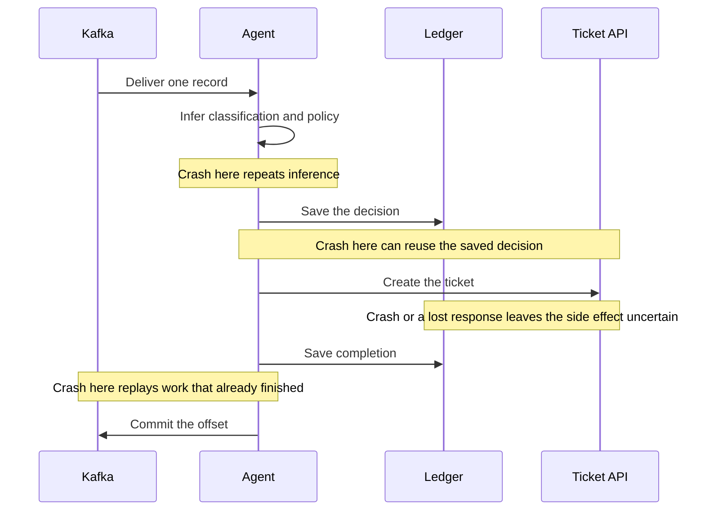
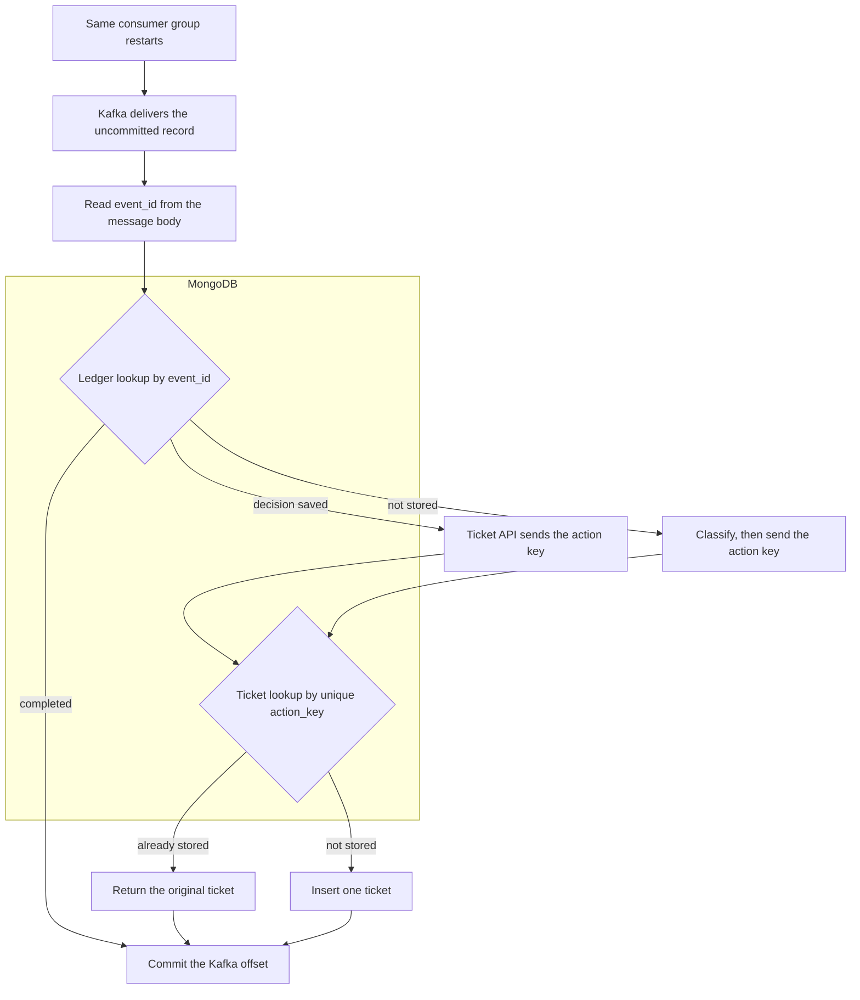

# ReplaySafe Agent

Failure recovery and idempotent tool execution in a Kafka-driven LLM agent.

## What we watch for in Kafka

The agent can create a ticket and still die before it commits the Kafka offset. After restart, Kafka delivers the same record again. The model may run again, and the ticket tool may run again.

Three writes each succeed or fail on their own: the Kafka offset, the agent ledger, and the ticket. The topic has one partition, so the message key does not choose a different destination. The producer still sets that key to `event_id`. Two records can share the key and the logical request and still arrive as two deliveries. The producer can also publish that same request twice.

## How an AI agent can go wrong when working with Kafka

Kafka still owes the agent that record, because the agent never confirmed it was finished.

A record stays on the partition after the agent reads it. Kafka advances the consumer group's position only when that group commits an offset. The commit means everything before this offset is done. Until the commit lands, a restart receives the same record again.

The agent commits only after its own work. For one request the order is:

1. Kafka delivers `request-0042` at offset 10.
2. The agent calls the model and creates the ticket.
3. The agent commits offset 11.
4. Only then does Kafka treat offset 10 as finished.

If the process dies at step 2, step 3 never happens. Kafka's stored position is still offset 10. The new process joins the same consumer group, so Kafka delivers `request-0042` again. The ticket from the first attempt is already stored, and the second attempt can create another one and call the model again.

That second delivery is the duplicate. Kafka treats an unconfirmed record as unfinished work, so it sends the record again.

## Key, partition, and consumer group

The topic has one partition and one consumer. Every record lands on that partition. The offset is the position on it.

The producer still sets the Kafka key to the UTF-8 `event_id`. With one partition the key does not change where the record goes, and it does not remove duplicates. Two publishes of the same `event_id` are still two offsets. The agent reads `event_id` from the Avro value. Identity, skip decisions, and the commit all go through the ledger, the ticket API, and then Kafka's own offset.

Kafka message headers are unused. The HTTP `Idempotency-Key` on the ticket call is separate. It carries the action key.

The consumer group is what makes a restart see the same record. The agent joins a fixed group id and commits manually. Kafka stores the committed offset for that group, topic, and partition. The agent does not keep a copy of the offset. If the process dies before commit, the group's stored position is unchanged, so the next process in the same group receives the record again. A new group would start clean and hide the crash. `auto.offset.reset=earliest` applies only when that group has no committed offset yet. Each strategy run uses its own group or topic, or an explicit offset reset.

## What we do about the replay

The replay stays. Kafka already stores the group's position, so the agent does not save the previous offset in order to skip the record. A private copy of the offset, used as a skip list, would drop a request whose ticket or ledger write never finished.

On the second delivery the agent looks up progress by `event_id` in the MongoDB ledger, and the ticket API looks up the action key:

1. A completed ledger record means the work is already done.
2. A saved decision can be reused when the strategy stored one.
3. The same idempotency key returns the original ticket.
4. The agent commits the Kafka offset only after that check, and any remaining work, are durable.

Strategy A does none of this, so the second delivery can create a second ticket. That is the failure the study measures. Strategies B and C use the ledger. Strategies C and D use the idempotent ticket call.

## What this study tests

The study measures how recovery strategies change duplicate tickets, missing work, repeated model calls, and latency when that record comes back.

The same requests and the same fault schedule run under four strategies:

| Strategy | What is turned on |
|---|---|
| A Basic retry | Retry only |
| B Completed-event dedup | A durable completion record |
| C Ledger and idempotent tool | Saved decisions, plus one ticket per action key |
| D Idempotent tool only | One ticket per action key, with no saved decision |

The runs test four claims:

1. Basic retry creates a second ticket when the crash falls after the ticket exists and before the offset commit.
2. A completion record still leaves a gap before that record is durable.
3. An idempotent ticket API keeps a single stored ticket for one action key.
4. A saved decision cuts repeat inference only after that checkpoint is durable. A crash before it still pays for inference again.

The report records what the runs show, including incomplete work and cases that cut against these claims.
